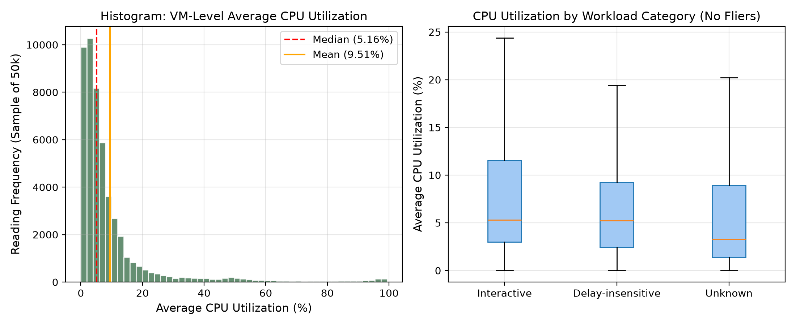
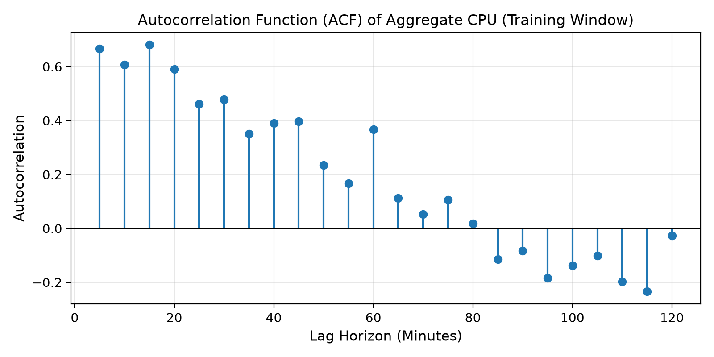
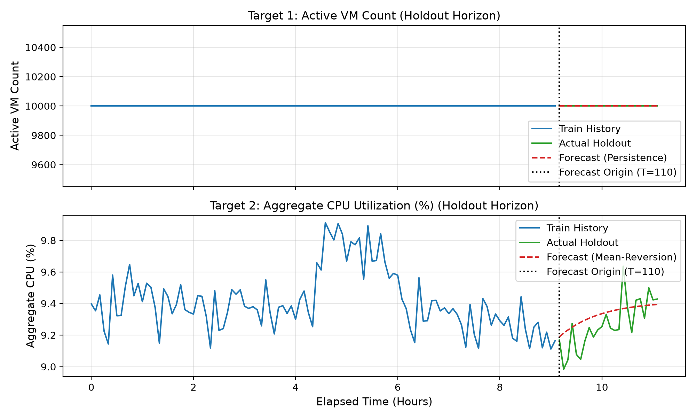

# Cloud Workload Forecasting & Analysis Report
**Atomity AI/ML Engineering Internship Take-Home Challenge**  
**Candidate Evaluation:** Microsoft Azure Public Dataset V2 (`data-v1` Curated Release)  
**Protocol:** 110 Observations Training Window / 24 Observations (2-Hour) Forecast Horizon  

---

## 1. Executive Summary

This report analyzes cloud virtual machine (VM) telemetry from the Microsoft Azure Public Dataset V2 (`data-v1` release) and evaluates a simple, leakage-safe forecasting method for near-term cloud workload demand.

The dataset contains 1,340,000 CPU readings from 10,000 VMs sampled every 5 minutes over approximately 11.1 hours (134 total time intervals).

From the raw readings, we construct two required aggregate targets:
1. **`active_vm_count`**: The number of unique VMs with an active CPU observation at each timestamp.
2. **`aggregate_cpu_utilization`**: The average CPU utilization percentage across all active VMs at each timestamp.

### Key Findings
- **Heavy Tail in VM Utilization:** Individual VMs are mostly idle (median CPU is $5.11\%$, and $49.05\%$ of readings are below $5\%$), but individual bursts reach up to $99.70\%$. When averaged over 10,000 VMs, aggregate CPU utilization is stable, staying within a narrow band of $8.98\%$ to $9.91\%$ with a mean of $9.39\%$ and standard deviation of $0.19\%$ percentage points.
- **No VM Churn in Trace:** All 10,000 VMs exist throughout the trace. The earliest VM deletion in the metadata occurs after the trace window ends. Consequently, `active_vm_count` is constant at 10,000 across all 134 intervals.
- **Model Selection via Expanding-Window Validation:** To avoid data leakage, models were evaluated exclusively on the first 110 training timestamps using expanding-window cross-validation with a 24-step horizon. A **mean-reversion forecasting rule with a fixed decay factor** ($\phi = 0.90$) achieved a cross-validation Mean Absolute Error (**MAE = 0.1876%**), outperforming the persistence baseline (MAE = 0.2056%) and a 15-minute moving average (MAE = 0.2353%).
- **Retrospective Holdout Evaluation:** On the final 24 held-out timestamps, the mean-reversion rule achieved an **MAE of 0.1055%**, **RMSE of 0.1290%**, and **sMAPE of 1.138%**, compared to the persistence baseline's MAE of 0.1468% (a $28.1\%$ relative improvement).
- **Practical Operational Takeaway:** Because individual VMs show significant burstiness even while fleet aggregate demand remains stable around $9.4\%$, infrastructure engineers cannot establish physical host capacity or headroom guarantees from aggregate CPU variability alone. Sizing must account for localized node contention and workload placement.

---

## 2. Dataset and Preprocessing

### 2.1 Telemetry Overview and Integrity Verification
The challenge release comprises two compressed CSV files:
- `vm_cpu_readings.csv.gz`: 1,340,000 rows containing 5-minute telemetry intervals (`timestamp`, `vm_id`, `min_cpu`, `max_cpu`, `avg_cpu`).
- `vm_metadata.csv.gz`: 10,000 rows containing VM attributes (`subscription_id`, `deployment_id`, `timestamp_vm_created`, `timestamp_vm_deleted`, `vm_category`, `virtual_core_bucket`, `memory_gb_bucket`).

Both files were verified against the provided `SHA256SUMS` file, matching the release hashes exactly.

| Quality Check | Result | Comment |
|---|---|---|
| Total Observations | 1,340,000 | Exactly 10,000 VMs $\times$ 134 intervals |
| Missing Values (NaN) | 0 (0.0%) | No missing fields in readings or metadata |
| Duplicate `(timestamp, vm_id)` | 0 (0.0%) | Exactly one reading per VM per timestamp |
| Timestamp Step | 300 seconds | Constant 5-minute grid from 0 to 39,900s |
| Timestamp Gaps | 0 | No missing intervals across the 11.1 hours |

### 2.2 Target Formulation
At each timestamp $t$, the two targets are calculated as follows:

$$\text{active\_vm\_count}(t) = \text{Count of distinct } \text{vm\_id} \text{ values present at } t$$

$$\text{aggregate\_cpu\_utilization}(t) = \frac{1}{\text{active\_vm\_count}(t)} \sum_{i \in \text{active VMs at } t} \text{avg\_cpu}_{i}(t)$$

Domain constraints are enforced:
- $\text{active\_vm\_count} \ge 0$ (integer)
- $0.0 \le \text{aggregate\_cpu\_utilization} \le 100.0$ (percentage)

### 2.3 Chronological Train / Holdout Split
Per the challenge instructions, the 134 time steps are split chronologically without shuffling:
- **Public Training Window:** First 110 observations ($t = 0$ to $32,700$ seconds, $\approx 9.17$ hours).
- **Holdout Evaluation Horizon:** Final 24 observations ($t = 33,000$ to $39,900$ seconds, exactly 2.0 hours).

The holdout observations were strictly held out during model fitting, parameter selection, and tuning.

---

## 3. Exploratory Workload Analysis

### 3.1 Individual VM vs. Aggregate Behavior
Examining the distribution of VM-level CPU readings shows marked right-skewness:

| Statistic | VM-Level `avg_cpu` (%) | VM-Level `max_cpu` (%) |
|---|---|---|
| Minimum | 0.01% | 0.02% |
| 25th Percentile | 2.48% | 4.42% |
| **50th Percentile (Median)** | **5.11%** | **9.12%** |
| 75th Percentile | 9.62% | 23.62% |
| 90th Percentile | 19.60% | 51.93% |
| 95th Percentile | 37.13% | 65.64% |
| **99th Percentile** | **87.35%** | **97.54%** |
| Maximum | 99.49% | 99.70% |

- Nearly half of all readings ($49.05\%$) are below $5\%$ CPU, and $76.17\%$ are below $10\%$.
- Only $3.08\%$ of readings exceed $50\%$ CPU.
- Because individual VM bursts are largely uncorrelated across 10,000 instances, the law of large numbers smooths out individual volatility at the fleet level. Aggregate CPU utilization has a standard deviation of only $0.19\%$ percentage points.

### 3.2 VM Lifetimes and Population Churn
Inspection of `vm_metadata.csv.gz` reveals:
- All 10,000 VMs have `timestamp_vm_created = 0`.
- The earliest VM deletion timestamp is `timestamp_vm_deleted = 40500`.
- Because the maximum observation timestamp is 39,900s, **all 10,000 VMs remain active throughout the entire dataset**.
- In this specific trace, `active_vm_count` is constant at 10,000.

### 3.3 Workload Segmentation
VMs are categorized in the metadata into three workload types:

| Workload Category | VM Count | Share (%) | Mean `avg_cpu` (%) | Std Dev (%) | Median (%) | P95 (%) |
|---|---|---|---|---|---|---|
| **Delay-insensitive** | 6,180 | 61.8% | 8.24% | 12.02% | 5.15% | 25.91% |
| **Interactive** | 3,091 | 30.9% | 11.49% | 16.97% | 5.28% | 49.41% |
| **Unknown** | 729 | 7.3% | 10.23% | 17.75% | 3.38% | 52.23% |

Interactive workloads show roughly $39\%$ higher average utilization and substantially higher 95th-percentile spikes ($49.41\%$ vs. $25.91\%$) than delay-insensitive batch jobs.

### 3.4 Autocorrelation Structure
Computing autocorrelation on the 110 training observations shows:
- **Lag 1 (5 mins):** $\rho_1 = 0.667$
- **Lag 2 (10 mins):** $\rho_2 = 0.607$
- **Lag 3 (15 mins):** $\rho_3 = 0.681$ (distinct 15-minute periodic spike)
- **Lag 6 (30 mins):** $\rho_6 = 0.477$
- **Lag 12 (60 mins):** $\rho_{12} = 0.367$

The spike at 15 minutes suggests recurring automated scripts or health checks commonly configured at 15-minute intervals.

---

## 4. Forecasting Methods and Rationale

We compared two simple baselines against one low-complexity candidate method:

### 1. Persistence Baseline (Last Observed Value)
$$\hat{y}_{t+h} = y_t, \quad \forall h \in [1, 24]$$
Assumes the workload demand remains at the last observed level.

### 2. Moving Average Baseline ($K=3$)
$$\hat{y}_{t+h} = \frac{1}{3} (y_t + y_{t-1} + y_{t-2}), \quad \forall h \in [1, 24]$$
Averages the last 15 minutes of readings to filter short-term noise.

### 3. Mean-Reversion Forecasting Rule with Fixed Decay Factor (Candidate Method)
$$\hat{y}_{t+h} = \bar{y}_{\text{train}} + \phi^h (y_t - \bar{y}_{\text{train}})$$
Where:
- $\bar{y}_{\text{train}}$ is the historical sample mean computed from the training history ($9.41\%$ on the 110-observation training window).
- $y_t$ is the last observed value at the forecast origin.
- $\phi = 0.90$ is a fixed decay factor (set as a constant, not fitted or learned from optimization).

**Straightforward Explanation:** Over short lead times ($h = 1, 2$), $\phi^h$ is close to 1, keeping the forecast near the latest observation $y_t$. Over longer horizons (as $h \to 24$ steps = 2 hours), $\phi^h$ decreases, smoothly pulling the forecast back toward the historical training mean $\bar{y}_{\text{train}}$.

---

## 5. Temporal Validation Design

To prevent future information from leaking into training:
- We used expanding-window cross-validation strictly within the first 110 observations.
- Each validation fold forecasts a 24-step horizon (2 hours), matching the holdout task.
- The initial window contains 50 points; the forecast origin advances by 12 points each fold.
- This creates 4 distinct validation folds covering observations 50 to 110.
- The holdout observations (110 to 133) were not touched during validation.

---

## 6. Baseline Comparison and Quantitative Results

### 6.1 Validation Results (Training Set Only)

| Model / Rule | Validation MAE (%) | MAE Std Dev | Validation RMSE (%) | Validation sMAPE (%) | Relative MAE (vs. Persistence) |
|---|---|---|---|---|---|
| **Mean-Reversion Rule ($\phi=0.90$)** | **0.1876** | $\pm 0.0646$ | **0.2166** | **1.985%** | **0.9126** (-8.74%) |
| Persistence Baseline | 0.2056 | $\pm 0.0779$ | 0.2387 | 2.164% | 1.0000 (Baseline) |
| Moving Average ($K=3$) | 0.2353 | $\pm 0.0712$ | 0.2661 | 2.480% | 1.1445 (+14.45%) |

The mean-reversion rule achieved lower MAE and lower RMSE than both baselines across the validation folds. Moving average performed worse than persistence because smoothing introduces lag during upward or downward transitions.

### 6.2 Error by Forecast Horizon (Mean-Reversion Rule)

| Horizon Lead Time | Step ($h$) | Validation MAE (%) |
|---|---|---|
| 5 minutes | $h = 1$ | 0.0459% |
| 15 minutes | $h = 3$ | 0.2156% |
| 30 minutes | $h = 6$ | 0.2515% |
| 60 minutes | $h = 12$ | 0.1940% |
| 120 minutes | $h = 24$ | 0.1606% |

Error is lowest at the 5-minute mark (0.0459%), rises over the first 30 minutes, and stabilizes as mean reversion anchors the forecast near the empirical average.

### 6.3 Retrospective Holdout Evaluation
After freezing the model selection and generating `predictions.csv`, we evaluated retrospective performance against the true 24 holdout observations:

| Target | Method | Holdout MAE | Holdout RMSE | Holdout sMAPE |
|---|---|---|---|---|
| `active_vm_count` | Persistence | 0.00 | 0.00 | 0.00% |
| `aggregate_cpu_utilization` | **Mean-Reversion Rule ($\phi=0.90$)** | **0.1055%** | **0.1290%** | **1.138%** |
| `aggregate_cpu_utilization` | Persistence Baseline | 0.1468% | 0.1664% | 1.591% |

Relative MAE on the holdout is $0.1055 / 0.1468 = \mathbf{0.7187}$, representing a **$28.1\%$ reduction in forecast error** over the persistence baseline.

---

## 7. Forecast Error and Failure Analysis

### 7.1 Performance During Peak Periods
We examined whether forecast accuracy degrades during higher-demand periods. Defining a peak period as timestamps where true utilization is above the 75th percentile ($> 9.388\%$):

- **Overall Holdout MAE:** 0.1055%
- **Peak Period Holdout MAE:** 0.0885%
- **Peak / Overall Ratio:** 0.8386

The rule achieved a lower MAE during the selected peak periods than across the full holdout, although this does not guarantee that every peak was forecast accurately.

### 7.2 Failure Modes and Vulnerabilities
1. **Unanticipated Fleet-Wide Bursts:** If an external event causes many VMs to spike simultaneously, the aggregate demand will depart from historical mean levels, and an autoregressive rule will under-forecast until new observations arrive.
2. **Structural Fleet Changes:** If a large tenant terminates thousands of VMs, the equilibrium mean $\bar{y}$ shifts permanently. A fixed historical mean would be slow to adapt without an adaptive rolling mean.
3. **Trace Length Limitation:** Because the trace is only 11.1 hours long, we cannot observe diurnal day-night cycles. Forecasting beyond 2 hours without day/night modeling is not recommended.

---

## 8. Operational Capacity-Planning Recommendation

### 8.1 Evidence from the Data
From the 110 training observations, we measure:
- Mean aggregate CPU utilization: $\bar{y} \approx 9.41\%$
- Aggregate CPU standard deviation: $\sigma_{\text{aggregate}} \approx 0.19\%$ percentage points

A $3\sigma$ buffer on the aggregate CPU series represents:
$$3 \times 0.1936\% \approx 0.58\% \text{ percentage points}$$

Adding this $3\sigma$ buffer to the expected aggregate CPU forecast ($\approx 9.35\%$ to $9.41\%$) gives a fleet-wide planning baseline of approximately **$10.0\%$ average CPU load**. This buffer accounts strictly for normal aggregate-level fluctuations across the 10,000 VMs in this 11-hour trace.

### 8.2 Important Practical Caveat
**Aggregate CPU variability alone cannot establish safe host capacity, a guaranteed headroom requirement, or an SLA/SLO.**

In a production cloud environment, physical servers do not host all 10,000 VMs at once; they host smaller subsets (for example, dozens of VMs per physical host). Individual VM behavior is heavily right-skewed:
- Median VM utilization is only $5.11\%$.
- The 95th percentile reaches $37.13\%$.
- The 99th percentile reaches $87.35\%$, and peak readings reach $99.70\%$.

If multiple bursty VMs happen to be co-located on the same physical server, localized CPU contention and throttling can occur even when the fleet-wide aggregate utilization remains low at $9.4\%$.

### 8.3 Practical Requirements for Host Sizing
Realistic capacity planning requires information beyond aggregate CPU percentages:
1. **Host-Level Utilization:** Telemetry measured at the physical server level (CPU ready time, core queue depth, context switching, memory and cache pressure).
2. **Workload Placement:** Separating latency-critical Interactive VMs (which have higher utilization of $11.49\%$ and 95th-percentile spikes of $49.41\%$) from batch Delay-insensitive VMs ($8.24\%$ mean, $25.91\%$ P95).
3. **VM Sizing & Core Counts:** Weighting allocations by virtual core counts and memory sizes rather than treating each VM as an identical unit.
4. **Service Requirements:** Establishing headroom based on actual application latency targets and operational scaling lag rather than pure aggregate statistics.

---

## 9. Limitations and Future Improvements

1. **Short Observation Duration:** 11.1 hours is too short to estimate 24-hour diurnal patterns. Evaluating a multi-day trace would enable modeling daily business cycles.
2. **Constant VM Population:** In this curated slice, no VMs were created or deleted. In production, dynamic VM scaling and churn would require an active forecasting model for `active_vm_count`.
3. **Virtual Core Weighting:** `aggregate_cpu_utilization` averages VM percentages equally. Weighting VMs by their core count would provide a more direct reflection of physical compute load.

---
*Report completed using reproducible analysis on the official Microsoft Azure `data-v1` release.*
